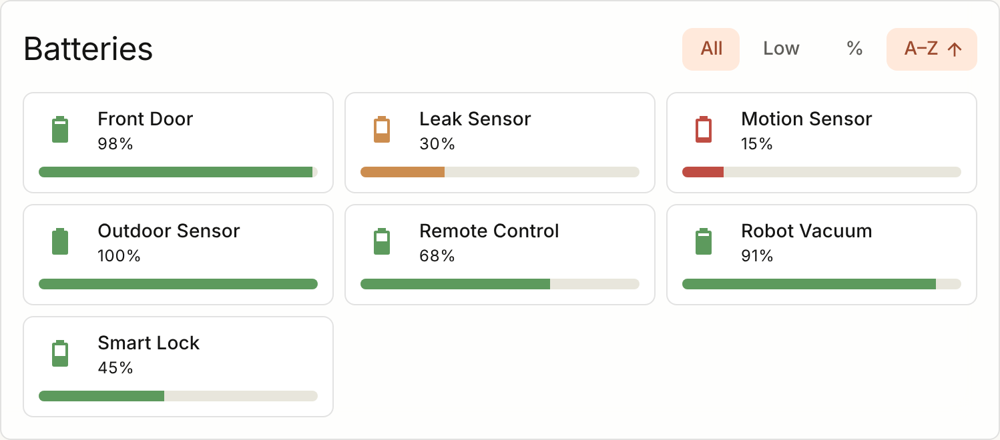
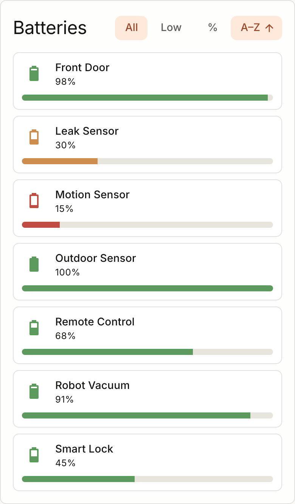

# Battery Card

<!-- ha-marketplace:exclude-start -->
[](https://github.com/roquerodrigo/ha-battery-card/actions/workflows/ci.yml)
[](https://github.com/roquerodrigo/ha-battery-card/releases/latest)
[](https://github.com/sponsors/roquerodrigo)

[](https://my.home-assistant.io/redirect/hacs_repository/?owner=roquerodrigo&repository=ha-battery-card&category=plugin)
<!-- ha-marketplace:exclude-end -->

See the battery level of every device in your home on one dashboard card,
with the weakest first and the low ones in a warning color. The card finds
your battery sensors by itself, so a new device shows up without editing the
card.





## Features

- One tile per battery, built from Home Assistant's own tile components, with
  the device name, the level and a bar. It looks and behaves like the tile
  cards around it.
- Sorted from the weakest battery up. Buttons on the card switch between
  level and name, and reverse the order.
- A button on the card shows only the low batteries.
- Low and warning levels that you choose, shown in your theme's colors in
  light and dark mode.
- Each tile carries the name of the device, including any name you gave it,
  instead of the name of the battery sensor.
- Select a tile to open the sensor's details and history.
- Set up everything in the visual editor.
- Available in English, Portuguese (Brazil) and Slovak, following the
  language of your Home Assistant profile.

## Requirements

- Home Assistant 2026.5.0 or newer.
- Battery sensors that report a percentage, as most integrations do.

<!-- ha-marketplace:exclude-start -->
## Installation

### Home Assistant Marketplace (recommended)

1. Select the **Open your Home Assistant instance** button above, or go to
   **Settings → Marketplace**, select **Add from link** in the upper right
   corner, enter `roquerodrigo/ha-battery-card` and select **Add**.
2. Select **Install**. The card is added to your dashboard resources.
3. Refresh your browser.

The Marketplace comes with Home Assistant 2026.11 and later. On older
versions, add this repository to HACS as a custom repository of type
**Dashboard** and install it from there.

### Manual

1. Download `battery-card.js` from the
   [latest release](https://github.com/roquerodrigo/ha-battery-card/releases/latest).
2. Copy it into `config/www/`.
3. Go to **Settings → Dashboards**, open the menu in the upper right corner
   and select **Resources**. If the menu is missing, turn on
   **Advanced mode** in your user profile.
4. Select **Add resource**, enter `/local/battery-card.js` as the URL, choose
   **JavaScript module** and select **Create**.
5. Refresh your browser.
<!-- ha-marketplace:exclude-end -->

## Usage

Edit a dashboard, select **Add card** and search for **Battery Card**. You can
set every option in the visual editor. In YAML, this is all you need:

```yaml
type: custom:battery-card
```

The card shows every sensor whose device class is battery, except the ones
you have hidden. To pick the batteries yourself, list them under `entities`:

```yaml
type: custom:battery-card
title: Door locks
threshold: 15
entities:
  - sensor.front_door_battery
  - sensor.back_door_battery
```

The two groups of buttons in the card header change the view without editing
the card. The first group, **All** and **Low**, filters the list. The second
sorts by level or by name, and selecting the active button again reverses the
order. These choices are not saved: the card goes back to its options when
the page reloads.

A level at or below the low threshold uses your theme's low battery color
(red by default). A level at or below the warning threshold uses the medium
battery color (orange by default). Every other level uses the high battery
color (green by default). The icon is the one Home Assistant shows for the
sensor, including any icon you picked for it, and the level follows your
language's number format.

## Options

| Option           | Accepts                          | Default                        |
|------------------|----------------------------------|--------------------------------|
| `title`          | Any text                         | Batteries, in your language    |
| `mode`           | `all` or `low`                   | `all`                          |
| `sort`           | `level` or `name`                | `level`                        |
| `sort_direction` | `asc` or `desc`                  | `asc`                          |
| `threshold`      | A percentage, 0 to 100           | `20`                           |
| `warning`        | A percentage, 0 to 100           | Twice `threshold`, at most 100 |
| `columns`        | A whole number, 1 to 12          | `5`                            |
| `entities`       | A list of entity IDs             | Every battery sensor           |

- `mode`: `low` shows only the batteries at or below `threshold`.
- `sort_direction`: `asc` puts the weakest battery, or the name closest to A,
  first.
- `threshold`: the level at or below which a battery is low.
- `warning`: the level at or below which a battery gets the warning color.
  Without it, the warning level follows `threshold`. In the visual editor,
  leave the field empty to keep it that way.
- `columns`: the most tiles per row on a wide screen. On narrower screens the
  card uses fewer, down to one tile per row on a phone.

## How it works

The card reads the battery sensors Home Assistant already has and updates as
soon as a level changes. It adds no entities and makes no requests of its
own.

## Troubleshooting

**A battery is missing from the card.** The card only finds sensors whose
device class is battery, and it skips hidden entities. Unhide the entity, or
add it to `entities`.

**A tile shows no percentage.** The sensor is unavailable or unknown right
now. These tiles always go to the end of the list and are left out of the
**Low** view.

**The dashboard says the custom element battery-card does not exist.** The
browser has not loaded the card yet. Refresh the page, clearing the cache if
needed. After a manual install, check the resource URL and type.

**Something else is wrong.** Open an
[issue](https://github.com/roquerodrigo/ha-battery-card/issues) with your card
configuration and any errors from the browser console.

## Known limitations

Battery sensors that only report low or normal, without a percentage, are not
supported.

## Support

This card is built and maintained on personal time. If it is useful to you,
consider [sponsoring the work](https://github.com/sponsors/roquerodrigo). It
keeps the fixes, the testing and the releases coming.

<!-- ha-marketplace:exclude-start -->
## Contributing

See [CONTRIBUTING.md](CONTRIBUTING.md) for the development setup and
workflow.

## License

[MIT](LICENSE)
<!-- ha-marketplace:exclude-end -->
